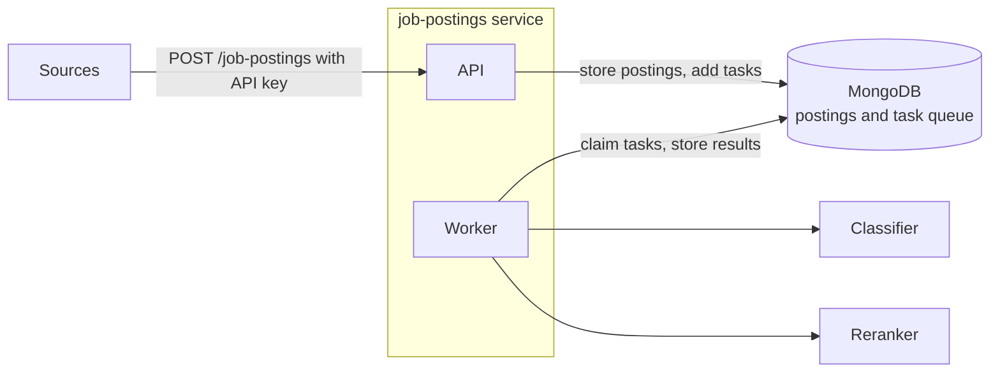

# job-postings

The entry point of the job pipeline behind [Horizon](https://www.tabiya.org/), Tabiya's open-source job matching
engine. The job-postings service is the single owner of job postings: it receives them, stores them, and moves each
one through classification and reranking.

> Status: early. The API and the worker work end to end, tested with the real classifier and reranker. See the
> [getting-started guide](docs/getting-started/README.md) to run it.

## How it works



The service has two parts in one codebase, run as separate processes from one Docker image: the API, which accepts
postings, and the worker, which processes tasks.

1. A source sends postings, with its API key, to `POST /job-postings`. The API checks the key, stores each posting,
   adds a `classify` task, and answers `202 Accepted` with the posting IDs.
2. The worker claims the `classify` task, sends the posting to the classifier, stores the classification, and adds a
   `rank` task.
3. The worker claims the `rank` task, sends the classified posting to the reranker, stores the ranking, and marks the
   task as done.

Each result is saved before the next stage starts, so a failure in one stage never repeats the previous one. Only
this service connects to MongoDB; the classifier and the reranker receive a posting and return a result.

The task queue is a MongoDB collection, one task per posting per stage, so no other broker is needed. A task is
claimed atomically, so two workers never take the same task, and a task left behind by a crashed worker becomes
claimable again after a lock timeout.

## Use it

Every request needs an API key in the `x-api-key` header. A key belongs to one source, which owns the postings sent
with it, and lists the countries it may post to.

```bash
curl -X POST http://localhost:8090/job-postings \
  -H "x-api-key: $KEY" -H "content-type: application/json" \
  -d '[{"external_id": "A-17", "title": "Electrician", "description": "Install and maintain wiring.", "country": "kenya"}]'
```

The body is an array. `external_id` (your own ID for the posting), `title`, `description` and `country` are required;
sending the same `external_id` again updates the posting and never creates a second one, so a request that failed or
timed out can simply be sent again. `GET /job-postings` and `GET /job-postings/{id}` show where each posting is in
processing and why it failed, if it did; `POST /job-postings/close` closes postings that are no longer open. The full
schema is at `/docs`.

The **[integration guide](docs/integration/README.md)** is for the developers of a source: every field, the result of
each posting, following a posting through its stages, closing, limits and errors, and an example script
([examples/send_postings.py](examples/send_postings.py)). [examples/client.html](examples/client.html) is a small
browser client for the same calls; serve it with `python3 -m http.server 8091 --directory examples` and open
http://localhost:8091/client.html (the compose stack allows that origin).

To create a key, run `python scripts/mint_api_key.py --source <name> --countries <country> ...`. It prints the key,
to give to the source, and the entry to add to `API_KEYS` (only the key's SHA-256 is stored).

## Run

```bash
docker compose up -d --build
curl http://localhost:8090/health
```

This starts MongoDB, the API (on host port 8090, or `JOB_POSTINGS_PORT`), one worker, and mock versions of the
classifier and the reranker, so postings go all the way through without the real models. The
**[getting-started guide](docs/getting-started/README.md)** has the full steps: creating an API key, sending a first
posting, running with the real classifier and reranker, running without Docker, every setting, and troubleshooting.

## Tests

```bash
poetry run pytest
poetry run pylint app
```

Tests start a throwaway MongoDB, downloaded on first use. Set `PYMONGOIM__USE_LOCAL_MONGOD=True` to use an installed
`mongod` instead.
